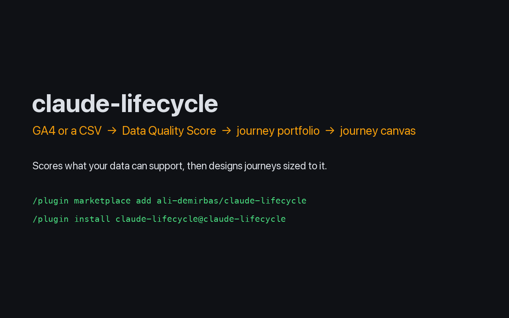
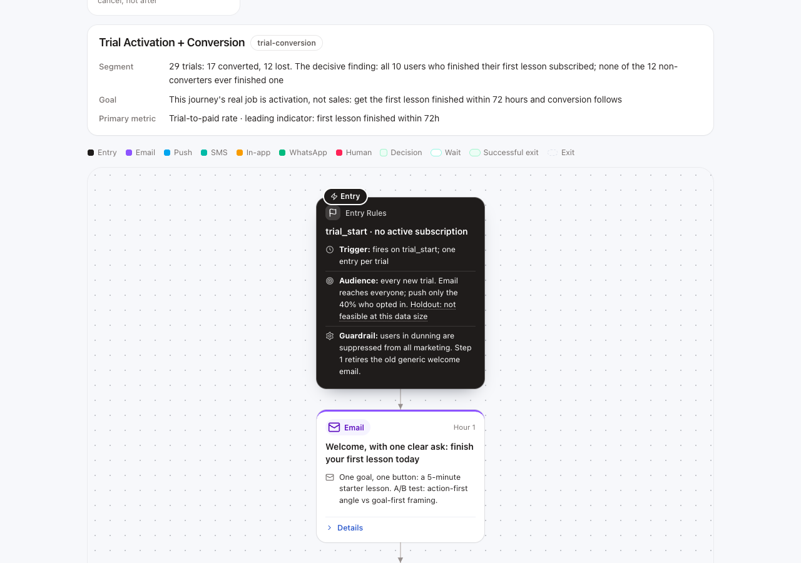

# Lifecycle Journey Builder

*Lifecycle marketing and CRM strategy as a Claude Code skill: customer journey design, behavioral segmentation, lifecycle messaging and channel copy for email, push, SMS, in-app and WhatsApp.*

**Journeys are a function of your data: most tools pretend otherwise.** A store tracking `add_to_cart` → `purchase` can run a branched 8-step cart recovery; a startup with three tracked events cannot. Lifecycle Journey Builder (`lifecycle-journey-builder`) is a [Claude Code](https://claude.com/claude-code) plugin that scores what your data actually supports first, then generates a portfolio of customer journeys (onboarding and activation, retention, churn prevention, win-back), plus rule-checked, sector-aware CRM copy for every step, sized to that reality instead of a template.


[](https://ali-demirbas.github.io/claude-lifecycle/demo/journey-canvas.html)



*Live output from the [zero-install demo](https://ali-demirbas.github.io/claude-lifecycle/demo/journey-canvas.html): every card, color, and number on this canvas comes from the sample dataset, not a mockup.*

---

## Why this exists

Every lifecycle tool ships the same five template flows, regardless of what data backs them. Handing a startup with three tracked events the same branching journey as a mature e-commerce store produces automations that can neither trigger nor be measured. This engine makes that constraint explicit instead of hiding it:

- **Data quality is scored, not assumed.** A 0–100 [Data Quality Score](docs/data-quality-score.md) decides whether you get 3-step time-based flows or 10+ step behavioral branching.
- **Journeys are a portfolio, not a listicle.** Eligibility is computed per pattern from required-event signatures; what your data can't support becomes a [tracking plan](templates/tracking-plan.md) telling you exactly which events unlock which journeys.
- **Copy is an engineered artifact.** Channel files carry hard limits and banned words; sector lexicons decide vocabulary; a reviewer agent adversarially checks every message before you see it.

## Questions this answers

- Which lifecycle journeys can my analytics data actually support today?
- What events do I need to start tracking before cart recovery, win-back or replenishment can work at all?
- How deep should a journey be — three time-based steps, or ten with behavioural branching?
- What belongs in a welcome, onboarding, retention, churn-prevention or win-back flow for my sector?
- How do I write CRM copy that respects each channel's character limits, banned words, consent rules and quiet hours?
- How do I measure a lifecycle journey honestly, holdout group included?
- How do I turn a journey's audience into a BigQuery query or a CDP trait?
- We are switching CRM tools — how do I describe our journeys in a way that survives the move?

## How it works


Full walkthrough with design decisions: [docs/architecture.md](docs/architecture.md)

**Zero-install demo:** the two HTML deliverables, rendered with sample data: [journey canvas](https://ali-demirbas.github.io/claude-lifecycle/demo/journey-canvas.html) · [channel copy canvas](https://ali-demirbas.github.io/claude-lifecycle/demo/message-copy.html)

## Quickstart

Inside Claude Code, add this repo as a plugin marketplace and install the plugin:

```text
/plugin install lifecycle-journey-builder --marketplace ali-demirbas/claude-lifecycle
```

On Claude Code older than 2.1.275, add the marketplace first:

```text
/plugin marketplace add ali-demirbas/claude-lifecycle
/plugin install lifecycle-journey-builder@lifecycle-journey-builder
```

Installed it before 0.4.0 as `claude-lifecycle`? Current Claude Code versions reserve names that start with `claude-`, so remove the old install (`/plugin uninstall claude-lifecycle`) and install it again under the new name. Skills are now called as `/lifecycle-journey-builder:lifecycle`.

Or run it from a local clone without installing (the scripts need Python 3.9+ and `pip install -r requirements.txt`):

```bash
git clone https://github.com/ali-demirbas/claude-lifecycle
claude --plugin-dir ./claude-lifecycle
```

Installing single skills with a skills CLI copies the skill text only, without the scripts, knowledge and templates the skills call, so use the plugin.


Using [Gemini CLI](https://github.com/google-gemini/gemini-cli) instead? `.gemini/extensions/lifecycle-journey-builder/` ships the same skills, rules and agents, generated from the same source files by `scripts/build_gemini.py`:

```bash
git clone https://github.com/ali-demirbas/claude-lifecycle.git
cd claude-lifecycle/.gemini/extensions/lifecycle-journey-builder && gemini extensions link .
```

Then, inside Claude Code:

```
/lifecycle connect          # score your data (GA4 via MCP, or point at a CSV)
/lifecycle journeys         # generate the portfolio
/lifecycle copy             # channel copy for the generated journeys
```

No data at all? `"/lifecycle journeys, my sector is fintech, no data"` works too: you get the sector playbook's priority journeys in their simple form, plus the tracking plan that upgrades them.

## The three tiers

| Tier | You have | You get |
|---|---|---|
| **T1** | GA4 or another analytics tool connected | Behavioral triggers, volume-aware conflict review; depth follows the Data Quality Score |
| **T2** | Row-level CSV / analytics export (one row per event or user) | Behavioral triggers; depth follows the Data Quality Score |
| **T2-aggregate** | A report or dashboard export (totals per period, funnel step, channel) | Event and funnel scoring, journeys designed as drafts: no per-user targeting until identity is confirmed |
| **T3** | Just your industry | Playbook-driven starter portfolio + a tracking plan to graduate to T1 |

Depth comes from the Data Quality Score, not the tier: under 40 simple, 40–69 standard, 70+ branched, and low volume caps it at standard ([docs/data-quality-score.md](docs/data-quality-score.md)).

## What's inside

| | |
|---|---|
| [`skills/`](skills/) | 11 skills: `lifecycle` routes; connect → map → intake → **journeys** → copy → export, plus audit, **results** (the measurement loop), **audience** (BigQuery SQL / CDP traits from journey audiences), and **qa** (trigger test payloads, positive and negative) |
| [`agents/`](agents/) | 4 subagents: event-analyst, journey-architect, and the copy-writer / copy-reviewer adversarial pair |
| [`knowledge/journey-patterns/`](knowledge/journey-patterns/) | 29 patterns (lead-nurture, abandoned-cart, trial-conversion, churn-prevention, winback, renewal-reminder, cancellation-winddown, unengaged-sunset, …), each with a required-event signature, anchored timing, exit checks before every send and DQS-tied depth scaling ([contract](docs/pattern-contract.md)) |
| [`knowledge/industries/`](knowledge/industries/) | 9 sector playbooks: funnel, event expectations, pattern priorities, timing. [Add yours](docs/adding-an-industry.md): it's a content PR, not code |
| [`knowledge/lexicons/`](knowledge/lexicons/) | Sector word choice: use/avoid tables, urgency rules, banned lists, regulated-context flag, plus [`locales/`](knowledge/lexicons/locales/) language overlays (per-language voice, emotion calibration, market red lines) |
| [`knowledge/brands/`](knowledge/brands/) | Company config layer (template here; each brand's file is written to `output/brands/` in your working folder, never into the plugin): per-brand tone, incentive policy, channels; rules inherit Company → Sector → Global, strictest compliance wins |
| [`knowledge/channels/`](knowledge/channels/) | Hard rules for email, push, SMS, in-app, WhatsApp: limits, spam lists, consent, quiet hours |
| [`templates/`](templates/) | Mandatory output formats + [`journey.schema.json`](templates/journey.schema.json), the CRM-agnostic journey definition |
| [`examples/`](examples/) | Full end-to-end outputs for each tier |

## Example output (excerpt)

A T1 e-commerce run produces a portfolio like:

| # | Journey | Stage | Priority | Depth | Status |
|---|---------|-------|----------|-------|--------|
| 1 | Cart recovery | Revenue | P0 | 8 steps, branched | ✅ generated |
| 2 | Browse abandonment | Revenue | P0 | 4 steps | ✅ generated |
| 3 | Post-purchase → 2nd order | Retention | P0 | 6 steps | ✅ generated |
| 4 | Winback (lapsed buyers) | Winback | P0 | 5 steps | ✅ generated |
| 5 | Replenishment | Revenue | P1 | n/a | 🔒 blocked (missing item-level `items` params) |

…where every ✅ is a full [journey doc](templates/journey-doc.md) (trigger, audience, exit criteria, step table, KPIs + holdout, Mermaid diagram) and every 🔒 lands in the tracking plan with the event that unlocks it. See [examples/ecommerce-full-ga4/](examples/ecommerce-full-ga4/).

For more journey designs to browse, the author's [Journey Library](https://alidemirbas.com.tr/en/lab/journeys) ([Türkçe](https://alidemirbas.com.tr/lab/journeys)) collects step-by-step lifecycle flows, drawn with the same card language as this engine's canvas. It is a gallery of patterns, not engine output: those journeys carry no copy and no data tier.

## Design principles

1. **One engine, data-driven sectors.** No `if industry == "fintech"` in skills; sector behavior lives in playbook/lexicon files, so extending the engine is a content contribution.
2. **Deterministic where it matters.** Eligibility, prioritization, and depth follow written rules ([DQS rubric](docs/data-quality-score.md)); the model's creativity goes into copy and sequencing, not into deciding whether a journey is possible.
3. **Honest by construction.** No fabricated benchmarks, no fake urgency, no journeys pretending untracked events exist. The never-do lists in every skill are load-bearing.

## Real-world validation

Beyond the eval suite, see [docs/real-world-validation.md](docs/real-world-validation.md) for what happened when someone ran this against a real product: what held up, and what gaps it surfaced that got folded back into the engine.

## Contributing

New industries, patterns, and sharper channel rules are welcome; see [CONTRIBUTING.md](CONTRIBUTING.md) and [docs/adding-an-industry.md](docs/adding-an-industry.md). Run `bash scripts/validate.sh` before opening a PR. Changes to skills or knowledge files should also pass the eval suite, which `python3 scripts/run_evals.py --all` runs end to end through the installed plugin (needs an authenticated `claude` CLI and costs real usage, so it runs before releases rather than on every PR).

## License

[MIT](LICENSE)

---

Built by [Ali Demirbaş](https://alidemirbas.com.tr)
