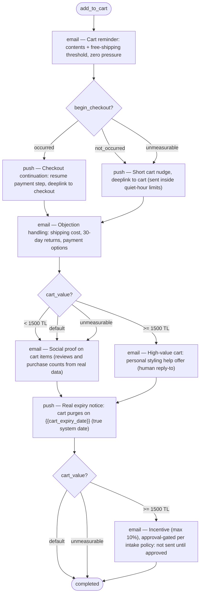

# Journey: Cart Recovery

**ID:** `ecom-abandoned-cart-01` · **Pattern:** [abandoned-cart](../../knowledge/journey-patterns/abandoned-cart.md) · **Priority:** P0
**Data tier:** T1 · **DQS at generation:** 74/100 · **Depth class:** branched (6 sends on the longest path) · **Class:** marketing
**Readiness:** ready to implement · **Validation:** `validate_output.py` 2.0.0 · schema 2.0 · passed

## 1. Objective (required)

Recover revenue from abandoned carts; primary KPI is **cart recovery rate** (purchases within the 7-day window / journeys entered).

## 2. Trigger & entry (required)

| Field | Value |
|---|---|
| Trigger type | event-based |
| Trigger | `add_to_cart` (arming window 1h — journey enters only if no `purchase` within 1h) |
| Entry conditions | cart non-empty after 1h · messageable on ≥ 1 channel (consent checked per channel per step) · identified user (`user_id` present) |
| Re-entry policy | after a 7-day cooldown · a newer cart while an instance is active restarts it (the newer cart supersedes the older one) |
| Quiet hours | push 22:00–09:00 blocked, staggered 09:00–11:00 on release; email avoids 00:00–06:00 (per [consent-and-quiet-hours.md](../../knowledge/compliance/consent-and-quiet-hours.md)) |

## 3. Audience (required)

- **Who enters:** identified users whose cart is non-empty 1 hour after the last `add_to_cart`, with no `purchase` since.
- **Who is excluded:** purchased in the last 24h (identity-stitched) · currently in a transactional flow (order/shipping) · cart value below 150 TL (low-value floor from intake) · users in `ecom-post-purchase-01`.
- **Estimated volume:** ≈ 650 entrants/week (estimate: identified & email-consented share of ~340 abandoned carts/day; from 61,900 `add_to_cart` / 90d).

## 4. Exit & success criteria (required)

- **Success (conversion) exit:** `purchase` (any, identity-stitched) · **Success window:** P7D (matches the real cart lifetime — guest carts purge on day 7).
- **Checked before every send, not only at entry:** `purchase`, `email_unsubscribe` (stops email sends), `push_opt_out` (stops push sends), `cart_emptied`. A queued message is cancelled the moment any of these has happened, including a purchase on another device.
- **Other exits:** journey completed, entered a higher-priority transactional flow.

## 5. Steps (required)

| Node | When | Channel | Message intent | Reached via | Copy ref |
|------|------|---------|----------------|-------------|----------|
| s1 | +PT1H after entry | email | Cart reminder: contents + free-shipping threshold, zero pressure | — | step-1 |
| s2 | +PT5H after entry | push | Checkout continuation: resume payment step, deeplink to checkout | d1=occurred | step-2 |
| s3 | +PT20H after entry | push | Short cart nudge, deeplink to cart (sent inside quiet-hour limits) | d1=not_occurred / unmeasurable | step-3 |
| s4 | +P2D after entry | email | Objection handling: shipping cost, 30-day returns, payment options | — | step-4 |
| s5 | +P4D after entry | email | Social proof on cart items (reviews and purchase counts from real data) | d2=< 1500 TL / default / unmeasurable | step-5 |
| s6 | +P4D after entry | email | High-value cart: personal styling help offer (human reply-to) | d2=>= 1500 TL | step-6 |
| s7 | +P6D after entry | push | Real expiry notice: cart purges on {{cart_expiry_date}} (true system date) | — | step-7 |
| s8 | +P6DT12H after entry | email | Incentive (max 10%), approval-gated per intake policy: not sent until approved | d3=>= 1500 TL | step-8 |

Branch notes: `d1` splits checkout-abandoners (`s2`) from cart-abandoners (`s3`) on whether `begin_checkout` fired in the first 5 hours; if that can't be measured for a user, they get the generic nudge `s3`. `d2` splits on cart value; a missing value takes the standard route. The two paths are exclusive, so their sends are never counted together: the worst path carries 4 emails + 2 pushes inside 7 days, exactly at the email cap, which is why the portfolio defers lower-priority sends for users in this journey.

## 6. Measurement (required)

| KPI | Type | Definition | Target |
|---|---|---|---|
| Cart recovery rate | primary | `purchase` within 7-day window / journeys entered | baseline after 4 weeks |
| Revenue per entrant | secondary | recovered `purchase.value` (TRY) / journeys entered | baseline after 4 weeks |
| Unsubscribe rate per send | guardrail | unsubscribes / delivered, per email step | < 0.3% per send |
| Push opt-out rate | guardrail | push permission revocations / push delivered | < 0.5% per send |

- **Design:** holdout, 10%, assigned consistently per user (hash of `user_id`); the control receives none of this journey's sends. Order and shipping transactional emails continue for both groups.
- **Primary outcome + window:** `purchase` within P7D.
- **Contamination:** users also eligible for browse-abandonment; the portfolio's entry gate defers one of the two.
- **Volume note:** ~650 entrants/week gives ~65 control users/week. Read the lift after at least 4 weeks (~260 control users); a small difference at that size is inconclusive, not a failure.
- **A/B plan:** step-1 subject line, Variant A ("Sepetin seni bekliyor…") vs Variant B ("{{product_name}} hâlâ sepetinde") — see [copy doc](04-copy-cart-recovery.md).

## 7. Frequency & compliance notes (required)

- This journey may consume a user's **entire weekly email budget** (4/4). While a user is active here: browse-abandonment is excluded by entry condition; NPS/milestone/anniversary sends are deferred until exit (portfolio §4 rule). On trigger conflict, Cart Recovery wins over Welcome (`ecom-welcome-onboarding-01` pauses).
- Consent: email requires İYS-registered opt-in (TR market, KVKK); push requires OS-level opt-in — both checked per step, not per journey. No SMS/WhatsApp steps (no consented audience).
- `s8`'s incentive requires human approval before activation (intake: max 10%, last step only).
- Urgency claims use real data only: `{{cart_expiry_date}}` is the actual purge date; no manufactured scarcity (lexicon rule).

## 8. Flow diagram (required)

## 9. Data gaps *(if applicable)*

- `cart_value` is computed CRM-side from synced `add_to_cart`/`remove_from_cart` events — a native cart-state attribute would remove drift risk.
- RFM attributes would allow suppressing the `s8` incentive for discount-affine users (they buy anyway); cross-referenced in the portfolio's tracking-plan summary ([02-portfolio.md §6](02-portfolio.md)).
